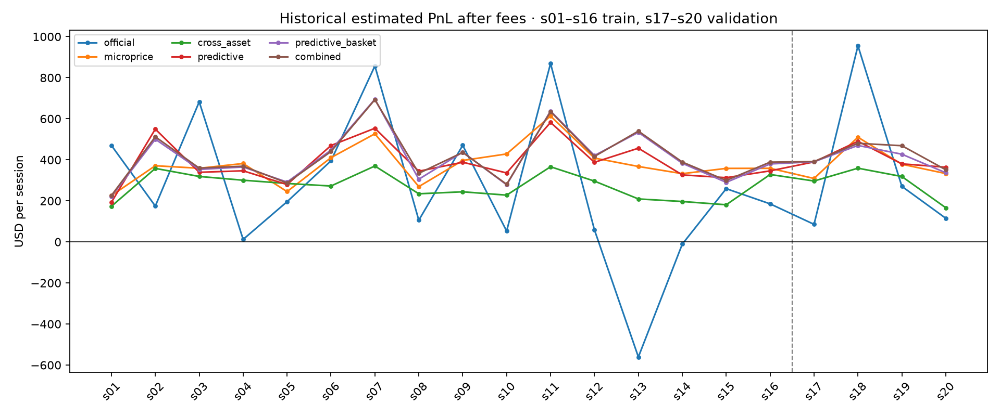
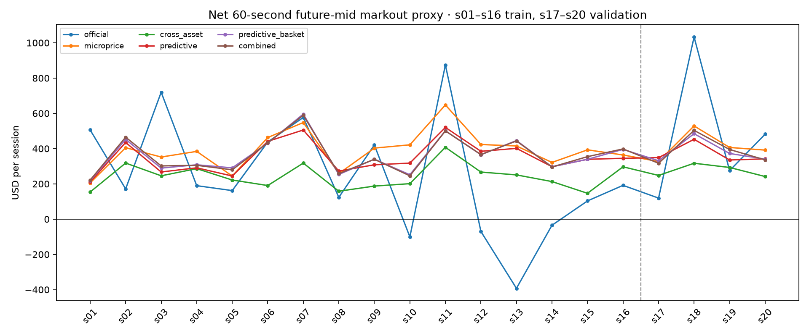
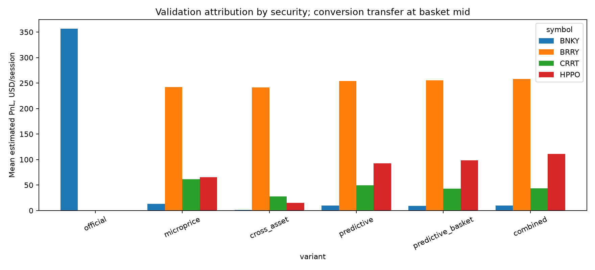

# Stage 5: historical backtest comparison

The official backtester replays recorded top-of-book data with default SDK rules. Its estimated PnL and future-mid markouts **are not the competition's hidden true-value score**. Historical orders do not move the recorded market; maker fills and IOC legs are optimistic.

## Protocol and candidates

Training sessions are s01–s16; validation is s17–s20. The final test s21–s24 is opened only after selection is frozen. Every row replays all 5,400 batches under `pqt_client.v2.backtest_strategy` with default rules. The official example quotes BNKY only from batch zero, with its original size and parameters; our variants share a 241-batch causal warmup. The official run is an external reference rather than a four-security controlled ablation. All our variants share the same quote, risk, warmup, and execution settings. `microprice` uses current microprice; `cross_asset` uses the saved one-feature cross-asset model; `predictive` uses the Stage 3 selected 60-second model; `predictive_basket` adds the observable HPPO basket adjustment; `combined` additionally enables executable ETF conversion trading.

## Training and validation

| Split | Variant | Mean PnL $ | Mean 60s markout $ | Markout c/share | Worst markout $ | Positive sessions | Mean stress $ | Fills | Shares | Rejects |
|---|---|---|---|---|---|---|---|---|---|---|
| train | official | 263.50 | 242.43 | 0.79 | -392.48 | 12/16 | -36.94 | 13,617 | 487,933 | 0 |
| train | microprice | 378.19 | 390.57 | 2.96 | 205.14 | 16/16 | 193.91 | 23,953 | 211,418 | 0 |
| train | cross_asset | 272.53 | 241.43 | 3.68 | 146.50 | 16/16 | 128.13 | 14,531 | 104,860 | 0 |
| train | predictive | 388.11 | 348.85 | 5.32 | 210.75 | 16/16 | 209.25 | 14,870 | 104,824 | 0 |
| train | predictive_basket | 408.62 | 360.89 | 5.08 | 217.90 | 16/16 | 217.13 | 15,778 | 113,557 | 0 |
| train | combined | 412.80 | 362.27 | 5.07 | 221.19 | 16/16 | 215.67 | 15,816 | 114,421 | 0 |
| validation | official | 356.58 | 477.36 | 1.42 | 119.36 | 4/4 | 92.77 | 3,749 | 134,536 | 0 |
| validation | microprice | 382.48 | 413.33 | 3.07 | 326.70 | 4/4 | 224.04 | 6,181 | 53,928 | 0 |
| validation | cross_asset | 285.09 | 274.85 | 3.98 | 241.59 | 4/4 | 158.45 | 3,957 | 27,628 | 0 |
| validation | predictive | 405.85 | 369.70 | 5.27 | 335.50 | 4/4 | 230.52 | 4,116 | 28,064 | 0 |
| validation | predictive_basket | 405.99 | 382.14 | 5.04 | 331.19 | 4/4 | 231.35 | 4,313 | 30,307 | 0 |
| validation | combined | 422.89 | 387.84 | 5.03 | 316.88 | 4/4 | 236.57 | 4,331 | 30,816 | 0 |

## Fees, execution, and risk

| Split | Variant | Fees $ | Maker fills % | Spread captured c/share | Max worst exposure | Messages | Msg/fill |
|---|---|---|---|---|---|---|---|
| train | official | -975.87 | 100.0 | 1.39 | 82.35 | 17,736 | 1.30 |
| train | microprice | -422.84 | 100.0 | 3.07 | 115.25 | 96,313 | 4.02 |
| train | cross_asset | -209.72 | 100.0 | 3.79 | 110.28 | 46,047 | 3.17 |
| train | predictive | -209.65 | 100.0 | 3.76 | 143.28 | 58,417 | 3.93 |
| train | predictive_basket | -227.11 | 100.0 | 3.53 | 183.62 | 59,527 | 3.77 |
| train | combined | -214.01 | 99.3 | 3.53 | 172.01 | 61,324 | 3.88 |
| validation | official | -269.07 | 100.0 | 1.58 | 82.20 | 4,805 | 1.28 |
| validation | microprice | -107.86 | 100.0 | 3.11 | 104.06 | 25,829 | 4.18 |
| validation | cross_asset | -55.26 | 100.0 | 3.90 | 104.89 | 12,863 | 3.25 |
| validation | predictive | -56.13 | 100.0 | 3.85 | 124.39 | 16,081 | 3.91 |
| validation | predictive_basket | -60.61 | 100.0 | 3.60 | 171.94 | 16,382 | 3.80 |
| validation | combined | -54.24 | 98.8 | 3.62 | 170.84 | 16,999 | 3.92 |

Per-security fill, share, maker/taker, fee, markout, and estimated PnL attribution are in `backtests/trainval_symbol.csv`; per-session maxima and order counts are in `backtest_comparison.csv`. Conversion is allocated among securities at the observed basket mid, with its fee charged to HPPO. That attribution adds to SDK total PnL but is an accounting convention, not an official score breakdown. Spread captured is maker-fill signed distance from the public mid at the execution batch, weighted by maker shares; it is not a realized cash profit measure.

| Variant | Symbol | Mean validation PnL $ | Mean 60s markout $ | Fills |
|---|---|---|---|---|
| official | BNKY | 356.58 | 477.36 | 3,749 |
| official | BRRY | 0.00 | 0.00 | 0 |
| official | CRRT | 0.00 | 0.00 | 0 |
| official | HPPO | 0.00 | 0.00 | 0 |
| microprice | BNKY | 13.24 | 16.79 | 405 |
| microprice | BRRY | 242.34 | 243.88 | 3,185 |
| microprice | CRRT | 61.20 | 67.62 | 968 |
| microprice | HPPO | 65.69 | 85.04 | 1,623 |
| cross_asset | BNKY | 0.98 | 9.67 | 269 |
| cross_asset | BRRY | 241.17 | 221.73 | 2,422 |
| cross_asset | CRRT | 27.65 | 27.57 | 560 |
| cross_asset | HPPO | 15.30 | 15.88 | 706 |
| predictive | BNKY | 10.06 | 11.09 | 215 |
| predictive | BRRY | 254.02 | 228.73 | 2,526 |
| predictive | CRRT | 49.34 | 41.86 | 555 |
| predictive | HPPO | 92.42 | 88.03 | 820 |
| predictive_basket | BNKY | 8.89 | 13.73 | 217 |
| predictive_basket | BRRY | 255.26 | 227.78 | 2,502 |
| predictive_basket | CRRT | 43.12 | 38.05 | 565 |
| predictive_basket | HPPO | 98.72 | 102.60 | 1,029 |
| combined | BNKY | 9.59 | 12.11 | 210 |
| combined | BRRY | 258.05 | 231.13 | 2,523 |
| combined | CRRT | 43.88 | 38.13 | 552 |
| combined | HPPO | 111.36 | 106.46 | 1,046 |

## Limit audit

Each row shows the maximum observed absolute position by symbol, maximum SDK worst-case weighted exposure, maximum messages in one batch, and maximum resting orders on any symbol. Exchange limits are ±1,000 HPPO, ±2,500 BNKY/CRRT, ±600 BRRY; weighted exposure ±600; 20 messages per batch; 40 resting orders per symbol.

| Split | Variant | HPPO | BNKY | CRRT | BRRY | Worst exposure | Max msgs/batch | Max open/symbol | Rejects |
|---|---|---|---|---|---|---|---|---|---|
| train | combined | 149 | 74 | 170 | 96 | 172.01 | 8 | 2 | 0 |
| train | cross_asset | 75 | 101 | 150 | 80 | 110.28 | 8 | 2 | 0 |
| train | microprice | 88 | 90 | 143 | 79 | 115.25 | 8 | 2 | 0 |
| train | official | 0 | 549 | 0 | 0 | 82.35 | 2 | 2 | 0 |
| train | predictive | 110 | 66 | 190 | 80 | 143.28 | 8 | 2 | 0 |
| train | predictive_basket | 149 | 77 | 172 | 80 | 183.62 | 8 | 2 | 0 |
| validation | combined | 150 | 62 | 90 | 83 | 170.84 | 8 | 2 | 0 |
| validation | cross_asset | 76 | 89 | 127 | 80 | 104.89 | 8 | 2 | 0 |
| validation | microprice | 71 | 66 | 110 | 53 | 104.06 | 8 | 2 | 0 |
| validation | official | 0 | 548 | 0 | 0 | 82.20 | 2 | 2 | 0 |
| validation | predictive | 91 | 62 | 77 | 80 | 124.39 | 8 | 2 | 0 |
| validation | predictive_basket | 144 | 62 | 90 | 80 | 171.94 | 8 | 2 | 0 |

## Limited parameter search

One factor at a time on training sessions s02, s06, s10, and s14: default; half-width 4 instead of 3; quote size 10 instead of 15; inventory skew 6 instead of 4; minimum quote edge 2 instead of 1 cent; volatility width weight 0.8 instead of 0.5; ETF margin 12 instead of 8 cents. No combinatorial sweep was run. News cooldown is held at 60 seconds because historical sessions contain no news. The stress metric deterministically retains 75% of maker fills, retains all taker fills, and charges one extra adverse cent per retained share. It is a deliberately pessimistic **future-mid markout sensitivity**, not a rerun of cash/inventory PnL.

| Case | Train sessions | Mean PnL $ | Mean 60s markout $ | Mean stress $ | Positive markout | Rejects |
|---|---|---|---|---|---|---|
| arb_margin_12 | 4 | 399.74 | 358.55 | 208.17 | 4 | 0 |
| base | 4 | 405.42 | 359.79 | 209.22 | 4 | 0 |
| edge_2 | 4 | 405.17 | 362.85 | 221.99 | 4 | 0 |
| size_10 | 4 | 348.75 | 304.03 | 185.00 | 4 | 0 |
| skew_6 | 4 | 361.76 | 331.70 | 197.02 | 4 | 0 |
| vol_width_08 | 4 | 352.91 | 313.56 | 190.16 | 4 | 0 |
| width_4 | 4 | 318.71 | 284.95 | 189.13 | 4 | 0 |

## Frozen selection

Selected variant: **microprice**. Parameter case: **base**. The microprice variant had $413.33 mean net 60-second public-mid markout on validation versus $387.84 for the combined strategy, and beat combined in all four sessions. It had zero rejects, positive markout in all 16 training and four validation sessions, and $224.04 mean stressed validation markout. The official BNKY-only baseline averaged $477.36 validation markout, but this was concentrated in s18; its mean stressed validation markout was $92.77 and it had four negative training markout sessions. The simpler microprice strategy is the more consistent choice under the predeclared protocol. These are proxies, not official score estimates.

`results/strategy_selected.json` records the exact overrides and was marked frozen before any holdout replay.

Paired validation 60-second markout differences for the frozen choice (selected minus comparison; four whole sessions):

| Comparison | Mean difference $ | Selected wins | Worst difference $ | Best difference $ |
|---|---|---|---|---|
| official | -64.03 | 2/4 | -504.43 | 207.33 |
| cross_asset | 138.48 | 4/4 | 78.86 | 211.65 |
| predictive | 43.63 | 3/4 | -22.03 | 75.72 |
| predictive_basket | 31.19 | 3/4 | -4.50 | 51.13 |
| combined | 25.49 | 4/4 | 9.81 | 55.46 |

## Sealed final test: s21–s24

The frozen selection was evaluated once on these sessions. Results did not alter the model, parameters, or selected variant.

| Variant | Mean PnL $ | Mean 60s markout $ | Worst markout $ | Mean stress $ | Fills | Rejects |
|---|---|---|---|---|---|---|
| official | -48.87 | -18.09 | -368.61 | -195.71 | 2,674 | 0 |
| microprice | 392.64 | 418.43 | 352.08 | 222.94 | 5,954 | 0 |

| Session | Variant | Estimated PnL $ | 60s markout $ | Stress markout $ | Fills | Worst exposure |
|---|---|---|---|---|---|---|
| s21 | microprice | 357.99 | 386.16 | 211.62 | 1499 | 98.00 |
| s21 | official | -304.44 | -368.61 | -444.44 | 580 | 81.75 |
| s22 | microprice | 296.05 | 352.08 | 189.30 | 1305 | 109.97 |
| s22 | official | 145.69 | 168.55 | -60.59 | 764 | 82.05 |
| s23 | microprice | 458.33 | 458.68 | 225.61 | 1561 | 94.15 |
| s23 | official | -208.70 | -134.30 | -205.60 | 440 | 82.35 |
| s24 | microprice | 458.19 | 476.81 | 265.25 | 1589 | 94.06 |
| s24 | official | 171.98 | 261.99 | -72.20 | 890 | 81.90 |

Frozen strategy holdout results by security:

| Symbol | Mean PnL $ | Mean 60s markout $ | Fills | Shares |
|---|---|---|---|---|
| BNKY | 5.46 | 12.30 | 392 | 4,816 |
| BRRY | 234.17 | 235.96 | 2,896 | 17,120 |
| CRRT | 75.36 | 78.28 | 1,081 | 13,082 |
| HPPO | 77.65 | 91.89 | 1,585 | 18,858 |

Frozen strategy holdout risk: maximum absolute positions HPPO 71, BNKY 72, CRRT 87, BRRY 80; maximum worst-case weighted exposure 109.97 of 600; maximum messages in one batch 8 of 20; total rejected orders 0.

## Limits of interpretation

The official score marks each fill to hidden true value about 60 seconds later with news adjustment; neither that path nor live queue/adverse selection is in this data. The midprice markout is an observable proxy. Overlapping fills and sessions sharing a simulator distribution do not create independent trade-level evidence. The conservative fill test is a postprocessing sensitivity, not a live fill model. News, halts, and reconnects cannot be measured from these historical files.
