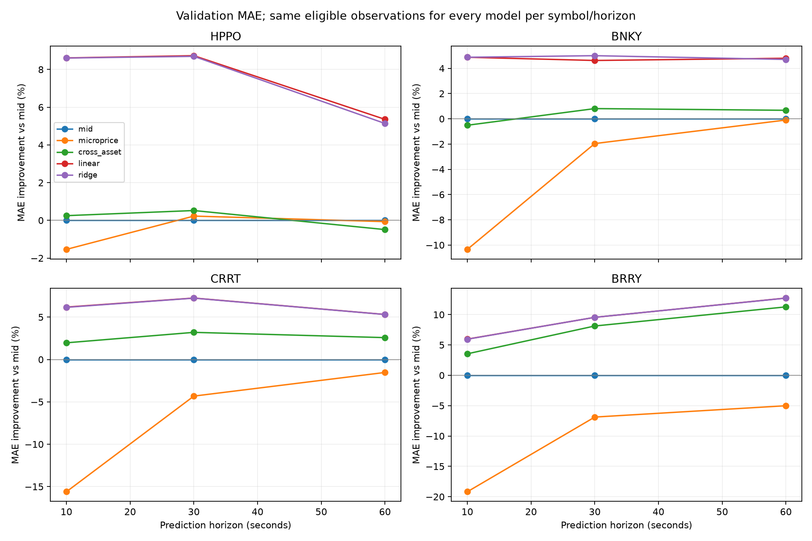
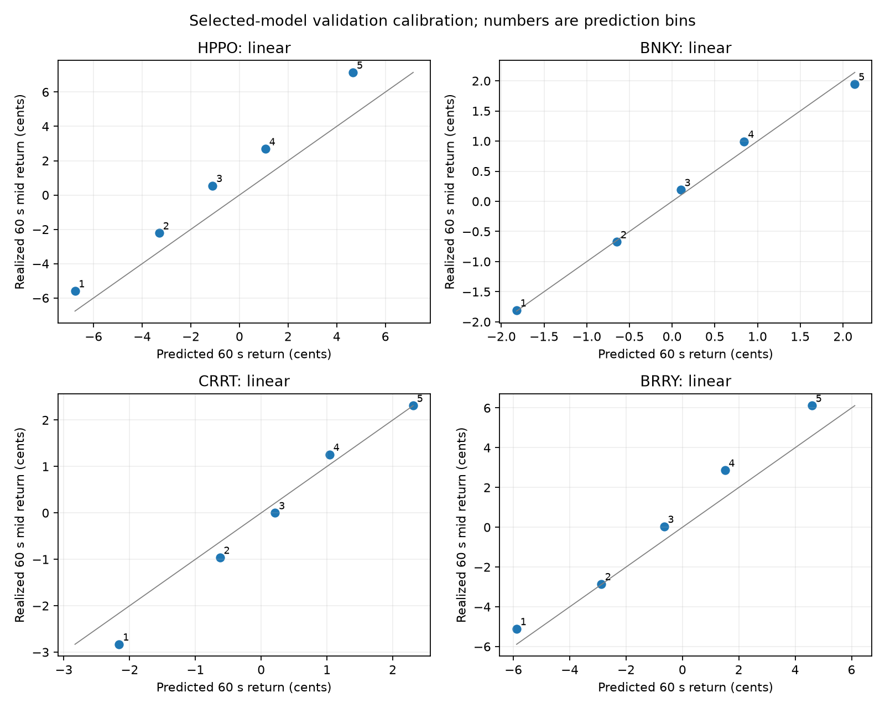

# Stage 3: fair-value prediction models

## Decision

Select **HPPO 60-second linear fair value** (`pqt-fair-value-v1/HPPO/60s/linear`) as the primary candidate for later strategy integration. It improves validation midprice forecasting over both public-price baselines, passes the stability rule in all four validation sessions, and produces the largest number of positive illustrative execution opportunities. This is a **model selection**, not an implemented trading strategy or evidence of official-score profit.

The saved [`fair_value_v1_selected.json`](../models/fair_value_v1_selected.json) also contains selected methods for all four symbols at 10, 30, and 60 seconds. Its default 60-second method is linear for every symbol. The other horizons are retained for later execution tests; `BNKY/10s` falls back to current mid because its learned-model improvement was inconsistent across validation sessions.

## Method and leakage controls

Models were fit on **s01–s16** and assessed on **s17–s20**. **s21–s24 were not read** by training or model evaluation. All models for a symbol and horizon use exactly the same eligible rows: two-sided current book, available causal features, at least 120 seconds of warmup, and a future midprice within that same session. The prediction made after batch `b` targets the public midprice at `b + 1 + 2h` for horizon `h` seconds, including the first 500 ms batch in which a message could execute. All quoted errors are in **cents per share**.

Inputs were fixed from Stage 2 before validation: short price momentum, 30-second aggressive flow, book imbalance, microprice offset, HPPO lead returns, and the ETF gap where relevant. Each linear model uses four or five chosen features. The cross-asset adjustment uses just one trained feature per symbol. `StandardScaler` means and scales were fit **only** on training sessions and saved with coefficients. Ridge strength was selected using four-fold **session-grouped cross-validation within s01–s16**; validation sessions were not used for that fit. Training sampled one row every 20 batches (10 seconds) to reduce repeated overlapping labels. Evaluation uses every eligible validation batch, but comparisons and stability are summarized by session rather than treating adjacent rows as independent trials.

The five candidates are current midprice, current microprice, one-feature cross-asset adjustment, linear regression, and ridge regression. Gradient-boosted trees were not tried: linear and ridge were already nearly identical on validation, so additional complexity lacked a demonstrated reason. The official hidden true values, news adjustments, and score are unavailable; future **midprice** is a proxy target.

## Validation forecasting results

The table reports the average of four **session-level** 60-second MAE values. Each row's five candidates use identical observations. The chosen linear model's RMSE, directional accuracy on nonzero predicted and realized returns, and MAE improvement relative to current mid are shown at right.

| Symbol | Mid MAE | Micro MAE | Cross MAE | Linear MAE | Ridge MAE | Linear RMSE | Linear direction | Linear MAE gain vs mid |
|---|---:|---:|---:|---:|---:|---:|---:|---:|
| HPPO | 9.566 | 9.573 | 9.613 | **9.054** | 9.075 | 11.675 | 62.5% | 5.35% |
| BNKY | 3.395 | 3.398 | 3.372 | **3.232** | 3.235 | 4.080 | 60.7% | 4.80% |
| CRRT | 4.060 | 4.122 | 3.955 | **3.844** | 3.844 | 4.832 | 61.5% | 5.32% |
| BRRY | 6.551 | 6.879 | 5.813 | **5.717** | 5.718 | 7.252 | 68.7% | 12.73% |

Microprice alone is weaker than current mid at 60 seconds for all four securities. The single cross-asset adjustment helps BRRY substantially (11.27% MAE gain versus mid) but the multifeature linear model improves it further (12.73%). Ridge does not materially beat ordinary linear regression on these validation sessions.

| Symbol | Selected 10 s method / gain vs mid | Selected 30 s method / gain vs mid | Selected 60 s method / gain vs mid |
|---|---:|---:|---:|
| HPPO | linear / 8.61% | linear / 8.73% | linear / 5.35% |
| BNKY | mid / 0% | ridge / 5.00% | linear / 4.80% |
| CRRT | linear / 6.19% | linear / 7.25% | linear / 5.32% |
| BRRY | linear / 5.97% | linear / 9.55% | linear / 12.73% |

The selection rule required a learned model to beat the better *average* mid/micro baseline by at least 0.5% MAE and to beat that baseline in at least **three of four sessions**. It then selected the simpler learned model if it was within 0.2% of the best learned MAE. BNKY's 10-second linear model improved average MAE 4.88% but beat the current-mid baseline in only two of four sessions; the selected method is therefore mid.



## Stability, calibration, and regimes

At 60 seconds, the linear model improves on the best public-price baseline in **4/4 HPPO**, **4/4 BNKY**, **3/4 CRRT**, and **4/4 BRRY** validation sessions. The four-session mean MAE gain versus current mid is 0.512 cents for HPPO (95% session-level t interval **-0.155 to 1.180**) and 0.834 cents for BRRY (**0.356 to 1.311**). The HPPO interval crosses zero, so its forecasting gain remains uncertain despite consistent observed session signs. Only four validation sessions are available.

The 60-second linear calibration slopes (realized return regressed on predicted return) are **1.112 HPPO**, **0.892 BNKY**, **1.148 CRRT**, and **1.119 BRRY**. The HPPO model underpredicts some extreme moves: its highest validation prediction bin averages **+4.67** predicted versus **+7.14** realized cents. Its lowest bin averages **-6.76** predicted versus **-5.59** realized. Mean HPPO prediction error is **-1.60 cents** across validation sessions, indicating a validation-period drift or offset that should not be “fixed” using the held-out data. The full predicted-edge bins are saved in `model_diagnostics/model_edge_bins.csv`.



Using **training-only median thresholds** to classify validation regimes, HPPO's 60-second linear MAE improvement versus mid is **4.47%** in low-spread rows and **6.36%** in high-spread rows; it is **3.33%** in low-volatility rows and **6.79%** in high-volatility rows. BRRY improves **8.86%/16.72%** in low/high spread regimes. These are forecasting comparisons; a wider spread can still make trading worse. All regime results are in `model_diagnostics/model_regimes.csv`.

## Conservative transaction-decision proxy

For context, an illustrative **one-share markout** was computed at most once every 20 batches (10 seconds). A buy or sell signal used only the current prediction and current touch and required predicted edge beyond the touch by more than the **0.4-cent taker fee plus 1 cent**. A hypothetical 10-share IOC fill was counted only when the next batch had at least 10 shares at a non-adverse touch, with an extra **1 cent of adverse execution price** charged. The markout then used the future **midprice**, not hidden true value. It does not manage inventory, net exposure, order limits, queue competition, market impact beyond the one cent, or news; it is **not a trading backtest or official score**.

| 60 s linear model | Signals attempted | Hypothetical fills | Mean per-session proxy markout, cents/share |
|---|---:|---:|---:|
| HPPO | 397 | 262 | +2.19 |
| BNKY | 37 | 24 | -0.34 |
| CRRT | 30 | 23 | +0.19 |
| BRRY | 85 | 27 | +1.61 |

HPPO's four session-level proxy means are **+1.98, +4.58, +0.08, and +2.13** cents/share. BRRY has just 27 hypothetical fills and one validation session at **-3.48** cents/share, despite its strong forecast MAE gain. This supports testing HPPO first when an execution strategy is built, while treating BRRY's prediction edge cautiously.

## Saved inference and timing

`models/inference.py` loads the selected JSON artifact and accepts a sequence of observed batch records through the current batch. Each record contains a `batch`, current `top` of book by symbol, and that batch's public `trades`. `FairValuePredictor.predict(history, "HPPO", 60)` returns predicted future price and return in cents, horizon, training-residual RMSE as an **uncalibrated uncertainty scale**, and model ID. It refuses skipped batches or missing book sides required for that symbol. An empty BRRY side does not block BNKY or CRRT inference.

A parity test rebuilt features from a real historical window and matched the offline feature and saved-model predictions for all four securities to numerical precision. On this Mac, **200 four-symbol calls** from a 241-batch real window took **4.37 ms median, 4.50 ms p95, and 4.75 ms max**, well below the 500 ms exchange batch. This benchmark measures local inference only; the later live strategy must still handle SDK callbacks and message timing.

## Files and reproduction

```bash
.venv/bin/python research/train_models.py --data data --output models/fair_value_v1.json
.venv/bin/python research/evaluate_models.py --data data --model models/fair_value_v1.json --results results --selected-output models/fair_value_v1_selected.json
.venv/bin/python research/benchmark_inference.py --repeats 200
.venv/bin/python -m unittest discover -s research -p 'test_*.py' -v
```

`model_comparison.csv` contains all 60 symbol/horizon/model comparisons. `model_diagnostics/model_session_metrics.csv`, `model_edge_bins.csv`, and `model_regimes.csv` support the stability, calibration, and regime figures. The training artifact contains only coefficients and transformations fit on s01–s16; the selected artifact additionally records the validation-based method choices. The final-test sessions remain reserved for a fixed strategy and protocol.
