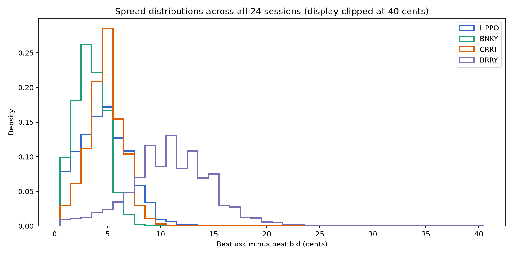
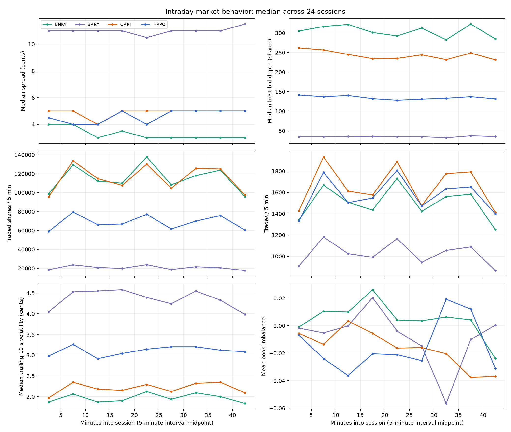
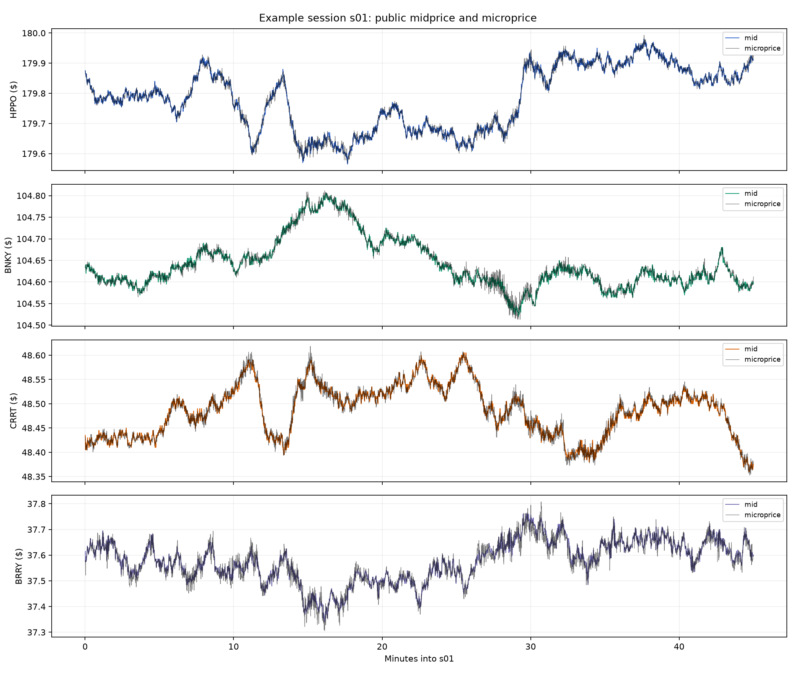
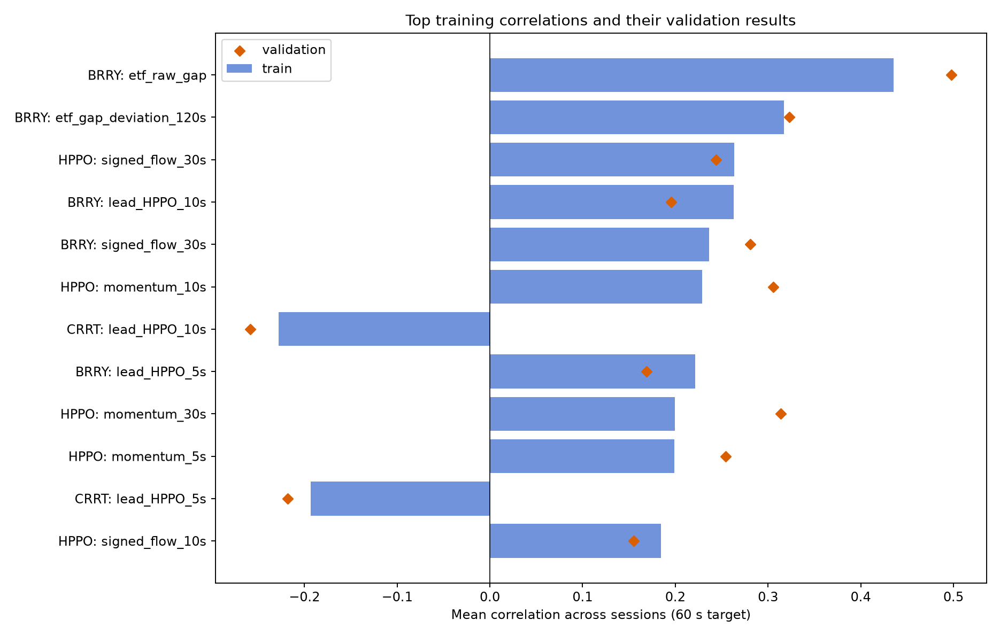
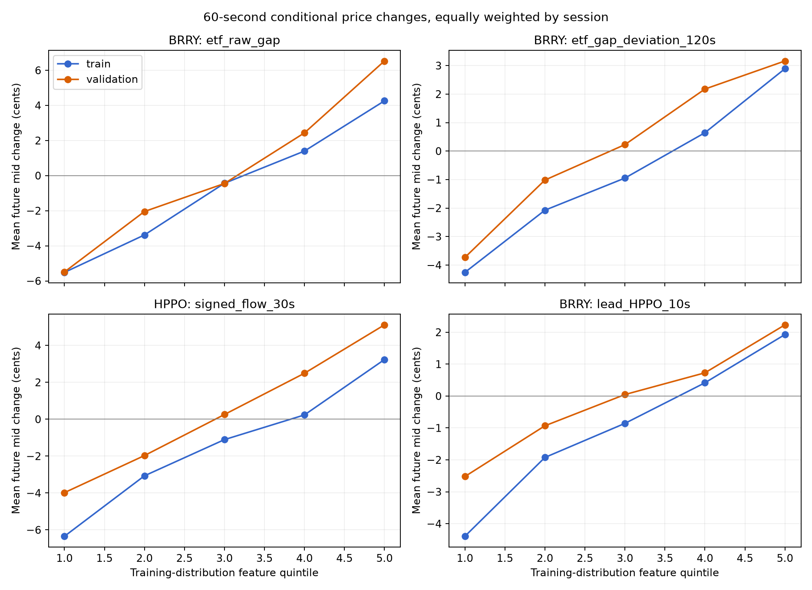

# Stage 2: market structure and predictive signals

## Scope and interpretation

This report uses the official 24-session historical pack and the Stage 1 data loader. Descriptive statistics and plots cover **all 24 sessions** and all four securities. Predictive statistics use `s01`–`s16` for training/discovery and `s17`–`s20` for a session-level validation check. `s21`–`s24` were used only for descriptive market summaries; their future price labels remain sealed for final strategy evaluation.

All prices and changes below are in **cents per share**. The five targets are `mid[b + 2h] - mid[b]` for `h ∈ {1, 5, 10, 30, 60}` seconds, with 500 ms batches. A separate timing check uses `mid[b + 1 + 2h] - mid[b + 1]`, allowing the first batch in which an order decided after batch `b` could execute. Rows without a full future horizon are excluded; the official score instead clamps its reference time to the session end. Neither target is a fill-price or official-score label. Every feature is computed from batch `b` and earlier, within one session. Missing bid/ask sides produce missing midprice, microprice, imbalance, and targets where appropriate; no blank side is filled with zero.

The reported correlation is the **mean of per-session Pearson correlations**. The 95% intervals use a Student-t interval across the 16 training or four validation session correlations. Quintile cutoffs are fit only on pooled training features, then applied unchanged to validation. Each session with a nonempty quintile contributes equally to that group's mean outcome. Overlapping observations within a session are highly dependent; they are not treated as independent evidence. Intervals are descriptive and unadjusted for the many features examined.

## Market structure across 24 sessions

| Symbol | Median spread | 90th percentile spread | Median bid depth | Median ask depth | Median shares/session | Median trades/session | Median trailing 10 s realized volatility |
|---|---:|---:|---:|---:|---:|---:|---:|
| HPPO | 4.5 | 7 | 136 | 147 | 606,625 | 14,161 | 3.10 |
| BNKY | 3 | 5 | 304 | 299 | 1,040,463 | 13,566 | 1.94 |
| CRRT | 5 | 7 | 235 | 253 | 1,045,779 | 15,027 | 2.21 |
| BRRY | 11 | 15 | 36 | 34 | 197,096 | 9,682 | 4.44 |

Each number is the median of the 24 per-session statistics. Depth and volume are in shares; realized volatility is `sqrt(sum of squared mid changes over the prior 20 batches)` in cents. BRRY is the thinnest, widest, and most volatile book. The audit found 663 absent bids and 824 absent asks in 518,400 book rows, so two-sided quote checks matter. All historical status rows are `TRADING`.

The `session_metrics.csv` and `interval_metrics.csv` files in `eda/` include midprice, microprice, spread, depth, imbalance, trade volume and frequency, signed aggressive shares, realized volatility, and price change by symbol, session, and five-minute interval. The intraday plots show substantial differences in liquidity by symbol; they do not support treating one fixed quote width as equally suitable for all four securities.







The additional [intraday pressure plot](eda/intraday_pressure.png) shows signed aggressive flow alongside book imbalance.

## Ranked 60-second candidates

This is a **predictive ranking**, sorted by absolute training correlation. All eight rows below have the training direction in 16/16 training sessions and 4/4 validation sessions. The CI column is the training 95% session-level interval. The last two columns use the **one-batch-delayed** 60-second target on validation sessions.

| Rank | Target / feature | Train corr (95% CI) | Validation corr | Delayed validation corr | Balanced move / simple cost hurdle |
|---:|---|---:|---:|---:|---:|
| 1 | BRRY / raw ETF gap | 0.436 [0.371, 0.500] | 0.498 | 0.474 | 5.72 / 6.15 |
| 2 | BRRY / ETF gap minus trailing 120 s mean | 0.317 [0.263, 0.372] | 0.323 | 0.299 | 3.19 / 6.15 |
| 3 | HPPO / signed flow past 30 s | 0.264 [0.193, 0.335] | 0.244 | 0.246 | 4.58 / 2.90 |
| 4 | BRRY / HPPO past 10 s move | 0.263 [0.206, 0.320] | 0.195 | 0.192 | 2.34 / 6.15 |
| 5 | BRRY / signed flow past 30 s | 0.236 [0.173, 0.299] | 0.281 | 0.284 | 3.96 / 6.15 |
| 6 | HPPO / own past 10 s move | 0.229 [0.178, 0.280] | 0.305 | 0.308 | 5.59 / 2.90 |
| 7 | CRRT / HPPO past 10 s move | -0.228 [-0.278, -0.177] | -0.258 | -0.256 | 1.75 / 2.90 |
| 8 | BRRY / HPPO past 5 s move | 0.222 [0.174, 0.270] | 0.169 | 0.165 | 1.92 / 6.15 |

For the final column, “balanced move” is half the **direction-adjusted** difference between the top and bottom feature quintiles' delayed future midprice changes. The crude one-way cost hurdle is `median spread / 2 + 0.4 cents taker fee`; it uses the median spread, not a simulated execution. It excludes next-batch quote changes, fill probability, market impact, inventory, news, and hidden true value. Even a positive move-minus-hurdle number is **not demonstrated trading profitability**.





For example, delayed HPPO signed-flow quintiles in validation range from **-4.02 cents** in the lowest group to **+5.13 cents** in the highest. Its sign-based directional accuracy on nonzero feature and target pairs is **60.0%** in validation, versus 57.6% in training. The analogous validation figures for HPPO 10-second momentum are -5.65 to +5.53 cents and 60.8%. BRRY's raw ETF gap reaches 67.2% directional accuracy, but its 5.72-cent balanced mid move is still below a 6.15-cent simple crossing hurdle. These are conditional market-price statistics, not traded results.

## Evidence by hypothesis

| Feature family | Evidence across horizons and sessions | Assessment |
|---|---|---|
| Best-level imbalance | BNKY training correlation falls from 0.344 at 1 s to 0.118 at 60 s; validation is 0.357 to 0.140. After a one-batch delay, BNKY's 1 s training correlation falls to 0.131. | Real short-horizon price information, with much of the immediate effect consumed before an order can act. The 60 s conditional move is below a simple crossing cost. |
| Microprice minus mid | Similar to imbalance: BNKY 60 s train/validation correlations 0.108/0.125. Algebraically, `microprice - mid = spread × imbalance / 2`, so it is largely a rescaled version of the same signal. | Predictive, but limited independent information and weak cost margin. |
| Own price momentum/reversion | BRRY's past 1 s move predicts the next 1 s negatively (-0.315 train, -0.311 validation); after one-batch delay the training correlation is -0.068. HPPO past 10 s move predicts 60 s positively (0.229 train, 0.305 validation). | Very short reversion is timing-sensitive. HPPO medium-horizon momentum is a stronger candidate for later execution tests. |
| Signed aggressive flow | HPPO past 30 s flow correlates 0.264/0.244 with 60 s change, positive in 16/16 and 4/4 sessions. Its delayed validation balanced move is 4.58 cents against a 2.90-cent simple hurdle. One-second flow is negatively related to immediate moves for all four symbols. | Strong candidate on HPPO, but the horizon-dependent sign and correlation with momentum require incremental-value testing. |
| ETF gap | `HPPO mid - BNKY mid - 2 × BRRY mid` predicts BRRY's 60 s move at 0.436/0.498; the trailing-centered version remains 0.317/0.323. HPPO's own 60 s gap correlation is near zero (-0.011 train). | The basket, particularly BRRY, tends to adjust. BRRY's wide spread and shallow depth make this a poor standalone taker-trade claim despite strong prediction. |
| Cross-asset lead/lag | HPPO past 10 s move predicts BRRY's 60 s move positively (0.263/0.195) and CRRT's negatively (-0.228/-0.258); each direction holds in all 16 training and four validation sessions. | Stable relationships, but their delayed balanced moves fall below the target symbols' simple crossing hurdles. |
| CRRT empirical relation | CRRT and HPPO contemporaneous 10 s returns correlate -0.231 on average in training and -0.265 in validation; mean univariate price beta is -0.105 and -0.125 CRRT cents per HPPO cent. The prespecified `CRRT 10 s return + 0.29 × HPPO 10 s return` feature has essentially no 60 s predictive correlation (-0.005 train, +0.044 validation). | CRRT is empirically negatively related to HPPO, but the simple hedged residual does not add a convincing 60 s signal. The published -0.29 exposure weight is a risk weight, not a directly comparable price beta. |

Selected training correlations at **all five horizons** show the different time scales:

| Target / feature | 1 s | 5 s | 10 s | 30 s | 60 s |
|---|---:|---:|---:|---:|---:|
| BRRY / raw ETF gap | 0.141 | 0.213 | 0.268 | 0.381 | 0.436 |
| HPPO / signed flow 30 s | 0.023 | 0.089 | 0.131 | 0.207 | 0.264 |
| HPPO / own momentum 10 s | 0.074 | 0.287 | 0.345 | 0.312 | 0.229 |
| CRRT / HPPO past 10 s move | -0.049 | -0.158 | -0.217 | -0.273 | -0.228 |
| BNKY / book imbalance | 0.344 | 0.294 | 0.239 | 0.153 | 0.118 |

## Conclusions and limits

The strongest **price-prediction** relationship is the BRRY ETF gap; its spread makes immediate taker trading unattractive under the crude hurdle. Because the gap includes BRRY's current quoted mid, some of its correlation could reflect BRRY quote reversion rather than a causal lead from HPPO. The trailing-centered gap remains predictive, but incremental value must be tested. HPPO's trailing signed flow and 10-second momentum are the clearest candidates for later model and execution testing. CRRT's response to HPPO is stable but small relative to CRRT's spread. No feature here has demonstrated official-score profitability, and no trading strategy was implemented in this stage.

The historical pack has no hidden true-value paths, news, or halts. The SDK backtester cannot reproduce live queue selection or participants reacting to our orders. Multiple features and horizons were screened, many are correlated, and only four sessions were used for validation. The sealed `s21`–`s24` sessions should be used only when a concrete strategy and evaluation protocol are fixed.

## Reproduce

```bash
.venv/bin/python research/explore_market.py --data data --output results/eda
.venv/bin/python research/analyze_signals.py --data data --results results
.venv/bin/python -m unittest discover -s research -p 'test_*.py' -v
```

Full split-level results for all 355 symbol-feature-horizon combinations are in `signal_analysis.csv`; `eda/signal_session_metrics.csv` contains the per-session numbers, `eda/delayed_signal_analysis.csv` contains the one-batch-delayed timing checks, and `eda/signal_ranking_60s.csv` is the reproducible 60-second ranking. The EDA CSVs cover all 24 sessions.
